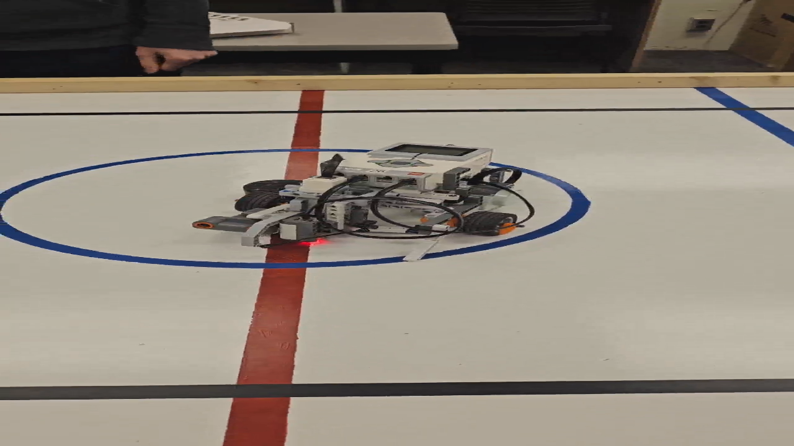
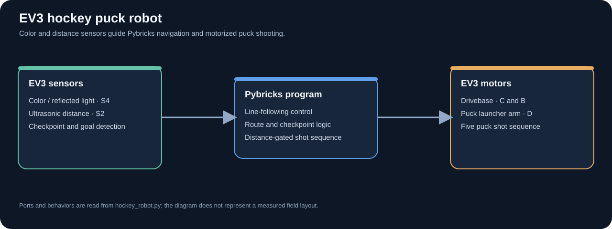

# EV3 Hockey Puck Robot

Pybricks MicroPython program for an EV3 robot that follows a marked route, detects course checkpoints, checks its position near the goal, and runs a puck-launching arm.

Click the image to open the [EV3 Hockey Robot Demo Video](ev3-hockey-puck-robot-demo.mp4).

## How It Works

- A color sensor on input port S4 supplies reflected-light readings for line following and checkpoint detection.
- An ultrasonic sensor on S2 checks distance near the goal.
- Drive motors on output ports C and B move the robot; the arm motor on D runs the puck-launch sequence.
- The route combines line-following corrections, color thresholds, fixed-distance segments, and goal-distance checks. The source includes five puck-launch sequences.

## Run The Program

Use an EV3 running a compatible Pybricks MicroPython environment. Transfer `hockey_robot.py` to the brick and run it with sensors and motors connected to the ports listed above. The route and sensor thresholds are tuned to a particular course layout; check reflected-light values and ultrasonic readings on the actual field before a run.

The demo video shows the physical robot on its course. The architecture image documents the software and sensor flow; it is not a wiring diagram.
